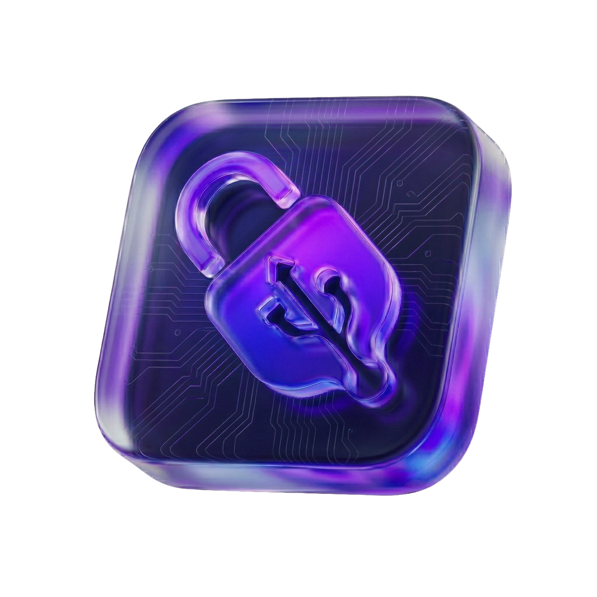

<p align="center">
  
</p>
<h1 align="center">USB-Vault</h1>
<p align="center">
  <strong>Hardware-Bound File Encryption</strong>
</p>

<p align="center">
  <a href="https://www.python.org/downloads/release/python-3110/"></a>
  <a href="https://www.gnu.org/licenses/gpl-3.0"></a>
  <a href="https://github.com/astral-sh/ruff"></a>
  <a href="https://github.com/pre-commit/pre-commit"></a>
  <a href="https://www.microsoft.com/windows/"></a>
</p>
<p align="center">
  
  
  
</p>

**Protect files with authenticated encryption derived from a selected USB
device fingerprint and, for stronger protection, an optional passphrase.
USB Vault processes files locally and never uploads their contents.**

> [!Caution]
> USB-Vault is undergoing a full migration to Rust to improve memory safety and performance. For more info visit **[USB-Vault Website](https://usbvault.app)** and wait for official information regarding migration, new features and expected release date. Please, be patient and if you have any questions, don't hesitate to contact **persky@usbvault.app**

***~Website update + migration progress info is expected to be published around 17-19 Oct 24-26 Oct~ LIVE*** 

---

## Your Personal Digital Safe

### What is `usb-vault`?

USB Vault derives an encryption key from:

1. **A USB-bound identifier:** a fingerprint calculated from identifiers
   reported by the selected USB storage device.
2. **An optional passphrase:** a secret known only to you and strongly
   recommended for sensitive files.

The USB fingerprint is an identifier, not a hardware-protected secret.
USB identifiers can potentially be read, copied, or emulated by a capable
attacker. A strong passphrase ensures that possession or reproduction of the
USB identifier alone is insufficient to decrypt the file.

### Why Should I Use It?

* **Offline-First Security**: Encryption and decryption happen locally. The
  application does not upload files, require an account, or send telemetry.
* **USB-Bound Access**: Vault files require the fingerprint of the USB device
  selected during encryption. Adding a passphrase protects against copied or
  spoofed USB identifiers.
* **Authenticated Encryption**: AES-256-GCM detects incorrect keys and
  modification of encrypted data.
* **Simple & Transparent**: The source code is public and can be independently
  reviewed.

### Important Recovery Notice

USB Vault has no recovery service, backdoor, account reset, or master key. If
the required USB fingerprint cannot be reproduced, or you forget the
passphrase, the encrypted data cannot be recovered.

Keep appropriate backups of important original files and protect your
passphrase independently of the USB device. Before deleting an original,
verify that the vault decrypts successfully with the intended USB device and
passphrase.

### How to Use It

The cryptographic core of USB Vault is free and open source. The graphical desktop interface is distributed exclusively as a standalone, portable application (`USB-Vault.exe`) available on the [official releases page](https://github.com/xperski/usb-vault/releases).

**Using the desktop application:**

1. Download `USB-Vault.exe` from the official releases page.
2. Optionally verify its SHA-256 fingerprint.
3. Run the executable. USB Vault requires no installation (it utilizes the Microsoft Edge WebView2 Runtime pre-installed on Windows 10 and 11).

In the application:

1. Open the **Encrypt** or **Decrypt** tab.
2. Drop a file into the window or select it using the file picker.
3. Select the required USB storage device from the list.
4. Enter the optional passphrase. The same passphrase must be used during decryption.
5. Start the operation and wait for it to finish. Do not disconnect the USB device or close the application during active processing.

Encryption creates a new file ending in `.vault`. Decryption restores the original file.

### Verify a Windows Download

Each release publishes the SHA-256 fingerprint of its final executable. A
matching fingerprint confirms that your downloaded file is byte-for-byte
identical to the published build.

1. Download `USB-Vault.exe`.
2. Open PowerShell in the folder containing the file.
3. Run:

    ```powershell
    Get-FileHash .\USB-Vault.exe -Algorithm SHA256
    ```

4. Compare the complete value in the `Hash` column with the SHA-256 value on
   the corresponding
   [GitHub release](https://github.com/xperski/usb-vault/releases) or the
   official [USB Vault website](https://usbvault.app/changelogs).

Compare all 64 hexadecimal characters; letter casing does not matter
(`A-F` and `a-f` represent the same value). Do not run the file if any
character differs. Delete it and download it again from an official source.

---

## Security Notes

USB Vault is built with practical security defaults, but no software can
guarantee safety in every environment. Use an updated, trusted computer;
protect the USB device; use a unique, strong passphrase for sensitive data;
maintain tested backups; and obtain builds only from official sources.
